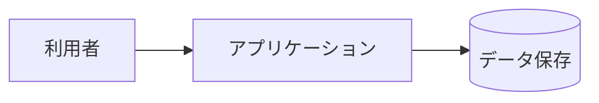

# システム構成

## 全体図

## 構成上の決定

| ID | 決定 | 理由 | 検証 | 上流 |
|----|------|------|------|------|
| ARC-001 | <例: 3 層 (表示 / 業務 / 永続化) に分け、表示層から永続化層を直接呼ばない> | | review | NFR-OPS-001 |

## 外部インターフェース

<なければ「なし」>

| ID | 相手 | 方式 | 内容 | 検証 | 上流 |
|----|------|------|------|------|------|
| EXT-001 | | | | test | REQ-EXT-001 |

## デプロイ

<デプロイしないもの (手元で動かすだけのツール、ライブラリの公開を人が行うなど) は「なし (理由)」と書く>

デプロイは検証の後に自動で、上の行から順に行う (ユーザーへの確認はしない)。秘密の値 (トークンなど) はここに書かず、置き場所 (環境変数名) だけを書く。

| 順 | 環境 | 配置先 | 方式 | 操作手段 (CLI / MCP) | 公開後の確認 | 切り戻し | 必要な秘密 (置き場所) |
|----|------|--------|------|----------------------|--------------|----------|------------------------|
| 1 | <例: staging> | <例: Vercel のプレビュー環境> | <例: vercel CLI でデプロイ> | <例: CLI `vercel` (トークンで対話なし) / MCP あり (このセッションで利用可)> | <例: /health が 200 を返す> | <例: 直前のデプロイに戻す> | <例: VERCEL_TOKEN (環境変数)> |

選んだ理由: <候補と比べた結果。CLI・MCP でエージェントができる範囲と、ユーザーの手間>

### ユーザーが一度だけする作業

エージェントにできない作業だけを書く (CLI・MCP でできるものは書かない)。詳細設計の終わりに、この一覧を案内する。

| 作業 | いつまでに | 手順の要点 |
|------|------------|------------|
| <例: Vercel のトークンを発行し、環境変数 VERCEL_TOKEN に設定する> | <例: 実装を始める前> | <例: 管理画面の Account Settings → Tokens> |
