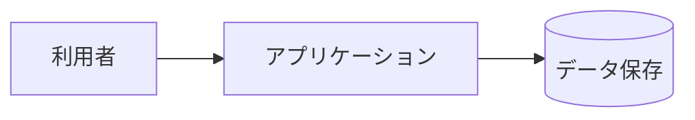

# システム構成

## 全体図

## 構成上の決定

| ID | 決定 | 理由 | 検証 | 上流 |
|----|------|------|------|------|
| ARC-001 | <例: 3 層 (表示 / 業務 / 永続化) に分け、表示層から永続化層を直接呼ばない> | | review | NFR-OPS-001 |

## 外部インターフェース

<なければ「なし」>

| ID | 相手 | 方式 | 内容 | 検証 | 上流 |
|----|------|------|------|------|------|
| EXT-001 | | | | test | REQ-EXT-001 |

## デプロイ

<デプロイしないもの (手元で動かすだけのツール、ライブラリの公開を人が行うなど) は「なし (理由)」と書く>

デプロイは検証の後に自動で、上の行から順に行う (ユーザーへの確認はしない)。秘密の値 (トークンなど) はここに書かず、置き場所 (環境変数名) だけを書く。

| 順 | 環境 | 配置先 | 方式 | 操作手段 (MCP / CLI / Git 連携) | 公開後の確認 | 切り戻し | ユーザーが用意する秘密 |
|----|------|--------|------|----------------------------------|--------------|----------|------------------------|
| 1 | <例: preview> | <例: Vercel のプレビュー環境> | <例: Git 連携で push ごとに自動デプロイ> | <例: MCP (Vercel コネクタ、接続済み) で状態を待つ> | <例: /health が 200 を返す> | <例: なし (プレビューなので戻さない)> | <例: なし> |

選んだ理由: <候補と比べた結果。MCP・CLI でエージェントができる範囲と、ユーザーの手間 (コピー・貼り付けする秘密の数)>

### サービス間で受け渡す設定値

アプリが実行時に使う値のうち、別のサービスから受け渡すもの。両方のサービスの MCP があれば、エージェントが読み出して書き込む (ユーザーにコピーさせない)。
値そのものはここに書かない。

| 設定値 (設定先での名前) | 取得元 (サービス・ツール) | 設定先 (サービス・環境・ツール) | 秘密か |
|-------------------------|---------------------------|----------------------------------|--------|
| <例: NEXT_PUBLIC_SUPABASE_URL> | <例: Supabase MCP の get_project_url> | <例: Vercel MCP で production の環境変数に設定> | <例: いいえ> |

<なければ「なし」>

### ユーザーが一度だけする作業

エージェントにできない作業だけを書く (MCP・CLI でできるものは書かない)。詳細設計の終わりに、この一覧を案内する。
秘密の値のコピー・貼り付けは、操作手段の選び方 (基本設計の手順書「デプロイ先の選び方」) で避けられなかったものだけにする。

| 作業 | いつまでに | 手順の要点 |
|------|------------|------------|
| <例: claude.ai のコネクタの設定で Vercel を接続する> | <例: 実装を始める前> | <例: 設定 → コネクタ → Vercel → 接続 (OAuth。キーのコピーは不要)> |
